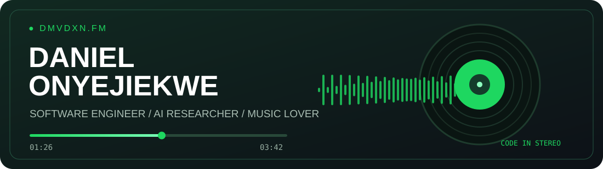
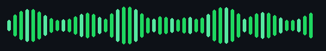

<!-- CODE IN STEREO | GitHub profile for @DMVDXN -->

  

  

  

  
<strong>🎧 Code in Stereo</strong> · Software engineering, human-centered AI, and a lifelong appreciation for music.

  
  
  
  <!-- Add your VERIFIED LinkedIn, resume, and contact links here. -->

---

### 🎙️ 01 · Behind the headphones

I'm **Daniel Onyejiekwe**, a **Computer Science M.S. student at Emory University** and a software developer who loves blending **engineering, research, and creativity**. I earned my **B.S. in Computer Science at Morgan State University**, graduating **magna cum laude**.

I'm interested in **human-centered AI, HCI, accessible technology, immersive experiences, and software that makes an impact**. Music is a big part of how I think and create, whether I'm building AI music tools, experimenting with interactive experiences, or finding the soundtrack to a new project.

- 🔬 **Research:** human-AI interaction, responsible AI, education, and interactive systems
- 💻 **Building:** full-stack applications, AI experiences, and VR projects
- 🏛️ **Working:** Digital Scholarship Assistant at Emory Center for Digital Scholarship
- 🎶 **Off the clock:** exploring music and the creative possibilities of technology
- 🤝 **Interested in:** software engineering opportunities, research, and meaningful collaborations

### 🎼 02 · Current rotation

| Track | What's on repeat |
| :-- | :-- |
| **01 / BUILDING** | Full-stack apps, AI-powered experiences, and developer tools |
| **02 / RESEARCHING** | Human-centered AI, HCI, fairness, and accessibility |
| **03 / EXPLORING** | Music, creative technology, and immersive interaction |
| **04 / LEARNING** | Algorithms, AI systems, and thoughtful software design |

### 🎚️ 03 · Studio equipment

**Languages**

**Frameworks and creative tools**

**Data, cloud and workflow**

### 💿 04 · Featured releases

*Selected work from my discography of research, applications, and experiments.*

| Release | The idea | Listen in |
| :-- | :-- | :-- |
| **🏆 SocialSense AI** | Award-winning AI social coaching concept focused on helping people manage social anxiety; built with a four-person team and a Meta Quest 3 prototype. | *Project link to add* |
| **🏛️ ICON History** | AI-powered interactive history learning, combining conversation and educational experiences. | *Project link to add* |
| **🛡️ GUARD** | Responsible AI research focused on evaluating and reducing bias in AI-generated content. | *Project link to add* |
| **🥽 Collision Course** | Immersive Unity VR concussion-awareness and training experience. | *Project link to add* |

<strong>🎵 Bonus tracks: music meets code</strong>

 

| Project | What it explores | Links |
| :-- | :-- | :-- |
| **Lyris** | AI-assisted lyric writing, poetry, and creative brainstorming. | [GitHub](https://github.com/DMVDXN/Lyris) · [Project website](https://lyris.vercel.app) |
| **Cover Crazy** | A music-focused project connected to the Spotify ecosystem. | *Project link to add* |

### 🏅 05 · Platinum records

- **🥇 1st Place**, PROPEL Center Future of Tech Innovation Challenge, on a four-person team for **SocialSense AI**
- **🎓 Magna Cum Laude**, B.S. Computer Science, Morgan State University
- **🔬 CRA UR2PhD Showcase** research presenter
- **🧑‍🏫 Teaching and mentorship** through computer science instruction and youth STEM outreach

### 📈 06 · On repeat: GitHub activity

  
  

<!-- The snake appears after the provided workflow runs successfully. -->

  

### 📻 07 · Let's collaborate

Have an idea where software, research, and creativity overlap? I'd love to connect.

  
  
  <!-- Add actual LinkedIn and email links here after verifying them. -->
  
<em>Built with curiosity. Powered by music. Written in code.</em>

