<!-- CODE IN STEREO | GitHub profile for @DMVDXN -->

  

  

  
  

  
<strong>🎧 Code in Stereo</strong> · Software engineering, human-centered AI, and a lifelong appreciation for music.

  
  
  
  
  
  

    

  <!-- Live Spotify card, refreshed every 30 minutes by .github/workflows/music-cards.yml -->
  <a href="https://open.spotify.com/user/pvygjnq0z2gb87uwweqf6pv8e">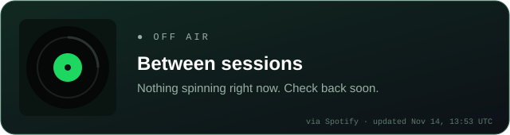</a>

 

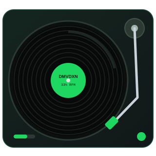

🎙️ LYRICS

<code>0:00</code> **[Intro]** 
*I'm **Daniel Onyejiekwe**, a software developer who loves blending engineering, research, and creativity.*

<code>0:12</code> **[Verse 1: The Background]** 
🎓 Earned my **B.S. in Computer Science** at **Morgan State University**, *magna cum laude* 
🏛️ Now a **Computer Science M.S. student** at **Emory University** 
📚 Digital Scholarship Assistant at the **Emory Center for Digital Scholarship**

🟨 <b>Annotation:</b> the Morgan State era

<blockquote>At Morgan State I took 1st place at the <b>PROPEL Center Future of Tech Innovation Challenge</b> with team Hax Lab for SocialSense AI, presented research at the <b>CRA UR2PhD Showcase</b>, and led the red team on <b>GUARD</b>. See <a href="#-press-quote">the press quote</a> and Featured Releases below.</blockquote>

<code>0:41</code> **[Chorus]** 
🎧 *Human-centered AI, HCI, accessible tech,* 
🎧 *immersive experiences, and software that makes an impact.*

<code>0:58</code> **[Verse 2: In the Studio]** 
🔬 **Researching:** human-AI interaction, responsible AI, education, and interactive systems 
💻 **Building:** full-stack applications, AI experiences, and VR projects

🟨 <b>Annotation:</b> where the research shows up

<blockquote><b>GUARD</b>: correcting how large language models characterize institutions (red team leader). 
<b>SocialSense AI</b>: AI social coaching for social anxiety, prototyped on Meta Quest 3. 
<b>ICON History</b>: AI-powered interactive history learning. 
<b>Collision Course</b>: Unity VR concussion awareness and training.</blockquote>

<code>1:09</code> **[Bridge: Off the Clock]** 
🎶 Music is a big part of how I think and create, whether I'm building AI music tools, experimenting with interactive experiences, or finding the soundtrack to a new project.

<code>1:20</code> **[Outro]** 
🤝 Open to **software engineering opportunities, research, and meaningful collaborations**.

<code>01:26 ━━━━━━━━━━━━━━━━━━━━━━━━● 01:26</code> ⇆ &nbsp; ◁ &nbsp; ❚❚ &nbsp; ▷ &nbsp; ↻ &nbsp;·&nbsp; up next: <b>02 · Current Rotation</b>

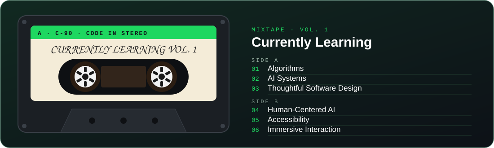

**🔀 Shuffle: off · 🔁 Repeat: on**

| # | Title | Artist | Genre | ⏱ |
| :-: | :-- | :-- | :-- | --: |
| ▶ 1 | **Building** | Full-stack apps, AI-powered experiences, and developer tools | Engineering | `3:41` |
| 2 | **Researching** | Human-centered AI, HCI, fairness, and accessibility | HCI · AI | `4:12` |
| 3 | **Exploring** | Music, creative technology, and immersive interaction | Creative Tech | `3:08` |
| 4 | **Learning** | Algorithms, AI systems, and thoughtful software design | Lifelong | `∞` |

<code>02:58 ━━━━━━━━━━━━━━━━━━━━━━━━● 02:58</code> ⇆ &nbsp; ◁ &nbsp; ❚❚ &nbsp; ▷ &nbsp; ↻ &nbsp;·&nbsp; up next: <b>03 · Studio Equipment</b>

🎛️ **CH 1 · Lead Vocals** · *languages*

🎹 **CH 2 · Instruments** · *frameworks and creative tools*

🎚️ **CH 3 · Mastering Rack** · *data, cloud and workflow*

<code>03:14 ━━━━━━━━━━━━━━━━━━━━━━━━● 03:14</code> ⇆ &nbsp; ◁ &nbsp; ❚❚ &nbsp; ▷ &nbsp; ↻ &nbsp;·&nbsp; up next: <b>04 · Featured Releases</b>

<em>💿 Selected work from my discography of research, applications, and experiments.</em>

<table>
  <tr>
    <td width="50%" valign="top" align="center">
      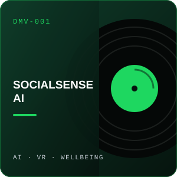
      <h3>🏆 SocialSense AI (feat. Hax Lab)</h3>
      
<kbd>AI</kbd> <kbd>VR</kbd> <kbd>Meta Quest 3</kbd>

      
Award-winning AI social coaching concept focused on helping people manage social anxiety; built with a four-person team and a Meta Quest 3 prototype.

      🎧 <a href="https://www.blackenterprise.com/morgan-state-students-win-tech-innovation-challenge/">Featured in Black Enterprise</a>
    </td>
    <td width="50%" valign="top" align="center">
      
      <h3>🏛️ ICON History (Classroom Mix)</h3>
      
<kbd>AI</kbd> <kbd>EdTech</kbd> <kbd>History</kbd>

      
AI-powered interactive history learning, combining conversation and educational experiences.

      🎧 <a href="https://icon-history.com/">Listen live</a>
    </td>
  </tr>
  <tr>
    <td width="50%" valign="top" align="center">
      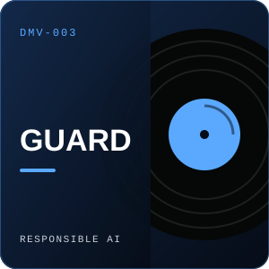
      <h3>🛡️ GUARD (Red Team Mix)</h3>
      
<kbd>Responsible AI</kbd> <kbd>LLMs</kbd> <kbd>Red Teaming</kbd>

      
Responsible AI research at Morgan State: a Claude skill (GUARD.md) that corrects categorical gist substitution in how large language models characterize institutions. I served as red team leader.

      🎧 <a href="https://www.morgan.edu/tepd/guard/">Project page</a> · <a href="https://scholar.google.com/citations?view_op=view_citation&hl=en&user=KM0qeRkAAAAJ&citation_for_view=KM0qeRkAAAAJ:u5HHmVD_uO8C">Read the paper</a>
    </td>
    <td width="50%" valign="top" align="center">
      
      <h3>🥽 Collision Course (VR Edition)</h3>
      
<kbd>Unity</kbd> <kbd>VR</kbd> <kbd>Health</kbd>

      
Immersive Unity VR concussion-awareness and training experience.

      🎧 <em>Unreleased: built, not yet deployed · demo on request</em>
    </td>
  </tr>
</table>

<strong>🎵 Bonus tracks: music meets code (live sites)</strong>

 

<table>
  <tr>
    <td width="33%" valign="top" align="center">
      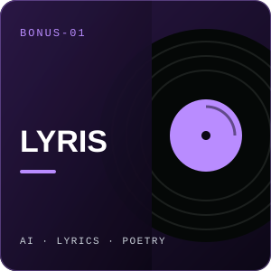
      <h3>✍️ Lyris (Songwriter's Cut)</h3>
      
<kbd>AI</kbd> <kbd>TypeScript</kbd> <kbd>Poetry</kbd>

      
AI-assisted lyric writing, poetry, and creative brainstorming.

      🎧 <a href="https://lyris.vercel.app/">Listen live</a> · <a href="https://github.com/DMVDXN/Lyris">GitHub</a>
    </td>
    <td width="33%" valign="top" align="center">
      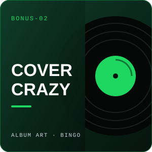
      <h3>🎨 Cover Crazy (Bingo Remix)</h3>
      
<kbd>Game</kbd> <kbd>TypeScript</kbd> <kbd>Album Art</kbd>

      
An album cover bingo game for music fans.

      🎧 <a href="https://covercrazy.vercel.app/">Listen live</a> · <a href="https://github.com/DMVDXN/CoverCrazy">GitHub</a>
    </td>
    <td width="33%" valign="top" align="center">
      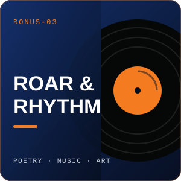
      <h3>🐻 Roar &amp; Rhythm (feat. Morgan State Creatives)</h3>
      
<kbd>Community</kbd> <kbd>JavaScript</kbd> <kbd>Arts</kbd>

      
A creative hub for poets, musicians, and artists at Morgan State University.

      🎧 <a href="https://roarandrhythm.vercel.app/">Listen live</a> · <a href="https://github.com/DMVDXN/MSU_Roar_and_Rhythm">GitHub</a>
    </td>
  </tr>
</table>

<code>04:07 ━━━━━━━━━━━━━━━━━━━━━━━━● 04:07</code> ⇆ &nbsp; ◁ &nbsp; ❚❚ &nbsp; ▷ &nbsp; ↻ &nbsp;·&nbsp; up next: <b>05 · Platinum Records</b>

| | Certification | Record |
| :-: | :-- | :-- |
| 💿 | **1st Place**, PROPEL Center Future of Tech Innovation Challenge ([press](https://www.blackenterprise.com/morgan-state-students-win-tech-innovation-challenge/)) | *SocialSense AI* (four-person team) |
| 📀 | **Magna Cum Laude** | *B.S. Computer Science*, Morgan State University |
| 💽 | **CRA UR2PhD Showcase** | Research presenter |
| 🎤 | **Teaching & Mentorship** | CS instruction and youth STEM outreach |

> ### 🎤 *"This is the first time I got to take an idea and turn it into an actual product and pitch it to investors, which was really cool and took me out of my comfort zone."*
> — Daniel, on winning the PROPEL Center Future of Tech Innovation Challenge with team Hax Lab · <a href="https://www.blackenterprise.com/morgan-state-students-win-tech-innovation-challenge/"><em>Black Enterprise</em></a>

<code>02:41 ━━━━━━━━━━━━━━━━━━━━━━━━● 02:41</code> ⇆ &nbsp; ◁ &nbsp; ❚❚ &nbsp; ▷ &nbsp; ↻ &nbsp;·&nbsp; up next: <b>06 · Tour Dates</b>

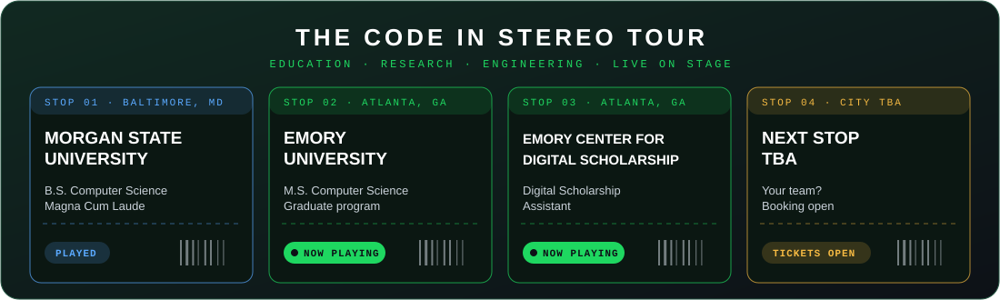

<code>03:05 ━━━━━━━━━━━━━━━━━━━━━━━━● 03:05</code> ⇆ &nbsp; ◁ &nbsp; ❚❚ &nbsp; ▷ &nbsp; ↻ &nbsp;·&nbsp; up next: <b>07 · On Repeat</b>

<em>📈 Listening stats, pulled live from GitHub and refreshed automatically.</em>

<!-- Wrapped + waveform are rebuilt every 30 minutes by .github/workflows/music-cards.yml -->
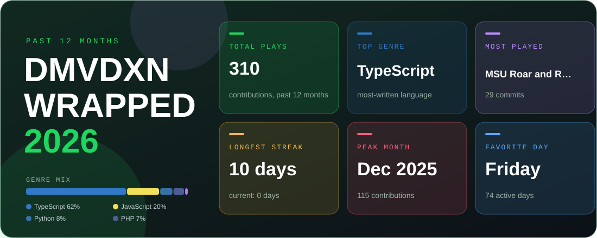

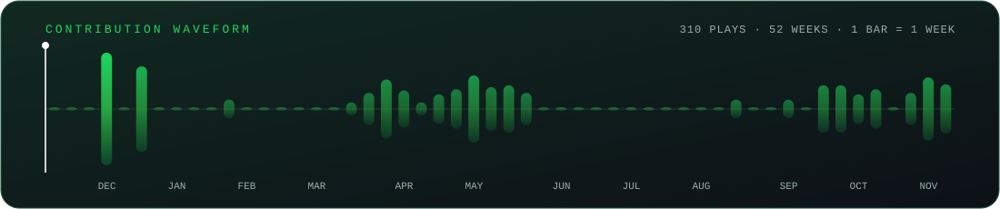

  
  

<!-- Beat machine: contribution calendar as a step sequencer, rebuilt by .github/workflows/music-cards.yml -->

<code>03:33 ━━━━━━━━━━━━━━━━━━━━━━━━● 03:33</code> ⇆ &nbsp; ◁ &nbsp; ❚❚ &nbsp; ▷ &nbsp; ↻ &nbsp;·&nbsp; up next: <b>08 · Let&#39;s Collaborate</b>

📻 Have an idea where software, research, and creativity overlap? Let's make the next track together.

<a href="https://danielonyejiekwe.com/">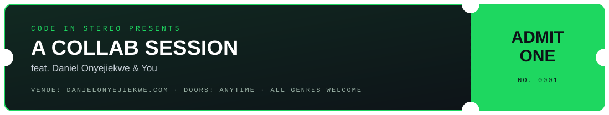</a>

  
  
  
  
  

 

<strong>📜 Liner notes &amp; credits</strong>

 

| | |
| :-- | :-- |
| **Produced by** | Daniel Onyejiekwe |
| **Recorded at** | Emory University, Atlanta, GA |
| **Early sessions** | Morgan State University, Baltimore, MD |
| **Engineered with** | Python · TypeScript · React · Unity · VS Code · Git |
| **Mastered by** | GitHub Actions (Now Playing, Wrapped, waveform, and beat machine refresh every 30 minutes) |
| **Special thanks** | Every collaborator, teammate, mentor, and student along the way, and you, for listening |

<code>03:42 ━━━━━━━━━━━━━━━━━━━━━━━━● 03:42</code> ↻ &nbsp; end of album · press replay anytime

<em>Built with curiosity. Powered by music. Written in code.</em>

